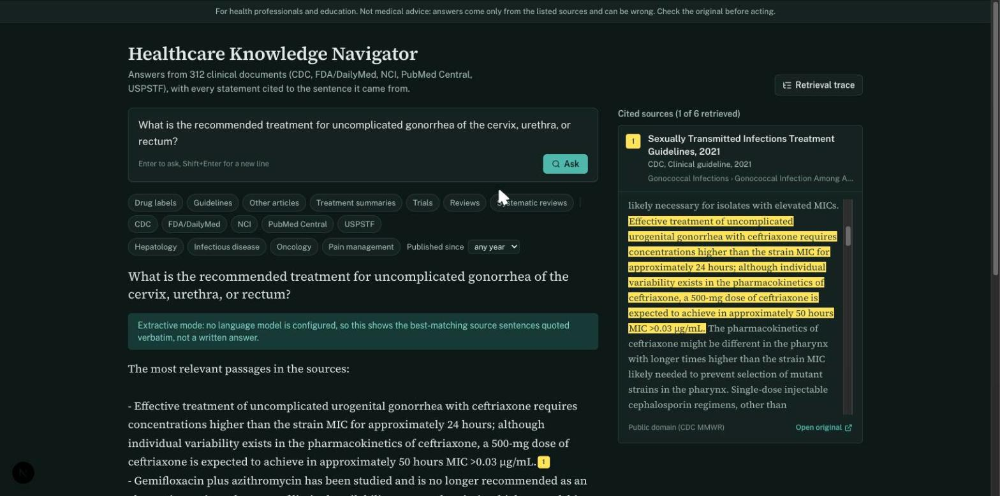
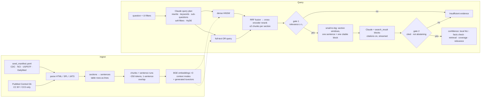

# Healthcare Knowledge Navigator

Ask a clinical question; get an answer drawn only from clinical guidelines, FDA drug labels
and open-access research, with **every statement cited to the exact sentence it came
from**, a **reliability score** for the answer, and a separate **evidence-strength**
rating for its sources. When the evidence isn't there, it says so instead of answering.



*Screenshot taken in extractive mode (no API key: the answer quotes source sentences
verbatim). With a key, the same view shows Claude's written answer, with the same
citations, highlighting and confidence panel.*

> For health professionals and education. Not medical advice. Answers come only from the
> listed sources and can be wrong; check the original before acting.

**Stack:** FastAPI · PostgreSQL + pgvector (hybrid dense + full-text search) · local
sentence-transformers models (BGE embeddings, BGE cross-encoder reranker, DeBERTa NLI) ·
Claude (`claude-opus-5-5`) for query planning and cited answers · Next.js + TypeScript +
Tailwind.

---

## How it works



The answer streams to the browser over Server-Sent Events as block-scoped events
(`block_start · text* · citation* · block_stop`), because Claude's citations arrive
*inside* text blocks, interleaved with their text. Clicking a citation highlights the
cited sentence inside its source section and deep-links to it in the original document
with a URL text fragment.

## The 15 RAG concepts, and where each one lives

| # | Concept | Implementation |
|---|---|---|
| 1 | Chunking | `ingest/chunk.py`: chunks are runs of whole sentences packed to ~250 tokens and never cross a section, so a regimen table is never split from its heading. |
| 2 | Chunk overlap | One-sentence overlap (`chunk_overlap_sentences`), so no idea is cut mid-sentence. |
| 3 | Embeddings | `ingest/embed.py`: BAAI/bge-base-en-v1.5, query instruction on queries only, L2-normalized. |
| 4 | Vector database | pgvector HNSW indexes, one per context mode (`alembic/versions/0001_initial_schema.py`). |
| 5 | Similarity search | `retrieval/search.py:dense_search`, with iterative index scan so filtered ANN does not starve. |
| 6 | Top-k | `RetrievalConfig.top_k` (8), capped at 2 chunks per section, because small-to-big sends whole sections. |
| 7 | Hybrid search | Dense ∥ Postgres FTS, fused with Reciprocal Rank Fusion (`retrieval/fusion.py`). FTS ORs terms, because `websearch_to_tsquery` ANDs them and long questions match nothing. |
| 8 | Metadata filtering | Hard filters from the UI (doc type, org, specialty, year) in SQL; soft filters inferred by the planner, dropped automatically when they starve results. |
| 9 | Query rewriting | `retrieval/plan_query.py`: one structured Claude call returns the rewrite, keywords and sub-questions (each retrieved and fused). |
| 10 | HyDE | The same call writes a guideline-style hypothetical passage, embedded as an extra dense arm. |
| 11 | Reranking | `retrieval/rerank.py`: BAAI/bge-reranker-base cross-encoder over the top 30 fused candidates. |
| 12 | Small-to-big | `retrieval/expand.py`: matched chunk → contiguous window of its section (≤1,500 tokens). |
| 13 | Contextual retrieval | Free heading-path prefix by default; Claude-written chunk context via the Batches API (`ingest/contextualize.py`). Each lives in its own embedding/tsvector so the eval compares them on identical chunks. |
| 14 | Grounding + citations | `generation/answer.py`: sections go to Claude as `search_result` blocks, one sentence per text block, so every citation resolves to exact sentence IDs (`generation/citations.py`). |
| 15 | Retrieval eval | `evals/run_retrieval.py`: an ablation ladder with bootstrap CIs; plus answer, abstention and calibration evals. |

## Confidence: two numbers, kept apart

**Answer reliability** estimates P(the answer is correct *and* supported by what it
cites). It is scored per answer **sentence**, against the union of everything that sentence's
blocks cite, from five features. None of them asks Claude to grade itself:

| Feature | Signal | Source |
|---|---|---|
| `nli_min` | lowest P(cited text entails the claim) across claims | local DeBERTa-v3 NLI cross-encoder |
| `facts_ok` | share of numbers and drug names found verbatim in the cited text | deterministic |
| `retrieval` | top cross-encoder score of the retrieved evidence | local reranker |
| `coverage` | share of substantive claims that carry a citation | structural |
| `relevance` | does the answer address the question (question × answer cross-encoder) | local reranker |

A claim the NLI model reads as contradicting its own citation caps the band at Low
regardless of score. A dose that drifts between source and answer is flagged by both
checks, by NLI and literally by the facts check, as in this tested example:

```
"ceftriaxone 500 mg IM"  cited to "Ceftriaxone 500 mg IM in a single dose…"  →  supported (E=1.00)
"ceftriaxone 250 mg IM"  cited to the same sentence                        →  conflict  (C=1.00, "250" missing)
```

The weights are **fitted, not hand-set**: `evals/calibrate.py` fits a non-negative
logistic regression on labeled answers, evaluated with 5-fold cross-validation **grouped
by question**. It reports Brier, AUROC, equal-mass ECE and AURC with bootstrap CIs
against a retrieval-only baseline and the prior. The High/Moderate bands are read off the
out-of-fold **risk–coverage curve**. Labels come from a separate Claude judge with its own
rubric, then human review with judge–human Cohen's κ. Until a fit exists, the API marks the
score `calibrated: false` and the UI says to treat it as a ranking, not a probability.

**Evidence strength** is a separate, display-only, GRADE-inspired rating of the cited
*sources*: document type, recency, superseded editions, and the number of agreeing
documents. It never enters the reliability score, because a guideline citation must not
inflate the confidence of a misreading.

Two abstention gates both fail closed: **gate 1** refuses before generation when the best
passage's relevance is below τ₁, and **gate 2** refuses an answer that carries no citations
or opens with the abstention sentence the system prompt requires.

## Results

All numbers below were produced by the scripts in `backend/evals/` on this corpus.
Re-run them with the `make` targets shown.

### Retrieval ablation (`make eval-retrieval`, free)

Measured on 24 hand-written questions over the full corpus (312 documents, 17,443 chunks):
12 guideline and label documents, plus 300 PubMed Central articles that act as realistic
distractors. Each rung adds one technique. Δ is the paired bootstrap change in nDCG@10
versus the previous rung; `*` means the 95% CI excludes zero.

| Rung | Recall@8 | MRR | nDCG@10 | Δ nDCG@10 |
|---|---|---|---|---|
| Dense (BGE) | 0.840 [0.72, 0.94] | 0.638 [0.49, 0.79] | 0.670 [0.54, 0.79] | |
| FTS, all question words OR'd | 0.368 [0.19, 0.56] | 0.144 [0.07, 0.22] | 0.200 [0.11, 0.30] | −0.470 * |
| FTS, IDF-pruned words | 0.444 [0.26, 0.64] | 0.250 [0.12, 0.40] | 0.289 [0.16, 0.43] | +0.089 * |
| Hybrid (RRF of dense + FTS) | 0.660 [0.49, 0.83] | 0.532 [0.38, 0.69] | 0.546 [0.41, 0.69] | +0.257 * |
| + cross-encoder rerank | 0.854 [0.73, 0.96] | 0.711 [0.57, 0.85] | 0.724 [0.59, 0.84] | +0.178 * |
| + heading-path prefix | 0.854 [0.73, 0.96] | 0.715 [0.57, 0.85] | 0.729 [0.60, 0.85] | +0.005 |

What this says:

- **Keyword search on raw questions is weak here, and naive hybrid search hurts.** Fusing
  a 0.29 arm with a 0.67 arm gives 0.55, below dense alone. The cross-encoder rescues the
  fused pool (+0.18) and ends 0.05 above dense, though that margin is within the CI. Without
  a reranker, this corpus is better served by dense retrieval alone.
- **IDF pruning was added after seeing the weak FTS rung**, so it was checked on both
  splits. It helped on dev (+0.13) and on test (+0.05).
- **The heading prefix is a null result** (+0.005); the LLM-context rung is pending the
  paid contextualization run.
- The planner rungs (query rewrite, keywords, sub-questions, HyDE) need an API key:
  `make eval-retrieval-plan YES=1`. The planner's keywords are expected to fix the
  lexical arm, and the eval will show whether they do.

### Abstention gate (`make tune-gate`, free)

τ₁ (minimum top rerank logit) is fit on the dev split by Youden's J and reported once on
test. Each split holds 14 answerable questions (including 2 false-premise questions that
must be corrected, not refused) and 6 off-topic or near-miss questions that should be
refused.

| Split | τ₁ | Should-refuse questions refused by gate 1 | Answerable questions wrongly refused |
|---|---|---|---|
| dev | +1.71 | 5 / 6 | 0 / 14 |
| test | +1.71 | 5 / 6 | 0 / 14 |

The two that pass gate 1 are instructive. "Migraine prophylaxis" retrieves the opioid
guideline's passage on *acute* migraine treatment: same condition, wrong question. "First-line
chemotherapy for pancreatic cancer" retrieves HER2 breast-cancer therapy. Both are left to
gate 2, which needs the model to recognize that the sources do not answer.

### Answers and calibration (`make eval-answers YES=1`, then `label`, `review`, `calibrate`)

These steps call Claude and were **not run** while building this repository, because no API key was available. The
pipeline is complete and tested offline (hand-built stream fixtures shaped after the documented API, an extractive answer
baseline, and a heuristic labeler used only as a smoke test). The paid run costs
roughly $20–25 at current Opus 5.5 prices, and each step prints its estimate first.

What *has* run is the free extractive baseline (`make eval-answers-extractive`), which
exercises every stage except the language model. That covers retrieval, both gates,
small-to-big, citation mapping and confidence features, across all four configurations:

| Config | Should-refuse questions refused | Answerable questions answered | Mean latency |
|---|---|---|---|
| full | 10 / 12 | 28 / 28 | 2.1 s |
| top-2 chunks | 11 / 12 | 26 / 28 | 1.6 s |
| no rerank | 10 / 12 | 28 / 28 | 1.1 s |
| gold documents withheld | — | 20 / 28 still answered from other documents | 1.8 s |

The last row is the failure the degraded configurations are designed to surface: with the
right document removed, retrieval still finds *something* plausible two-thirds of the time.
Only gate 2 (the model saying the sources do not answer) and a calibrated score can catch
that, which is why the Claude run matters.

As a pipeline smoke test only, the heuristic key-fact labeler marks 25 of 107 extractive
answers as stating every key fact. Fitting on those labels puts nearly all the weight on
`relevance`. That is what you'd expect: verbatim quotes saturate the faithfulness features
(NLI, facts check, coverage ≈ 1.0), so only relevance varies. These labels are too weak to
calibrate on, so `calibrate` refuses to write weights from them.

## Quickstart

```bash
make setup                 # uv + npm
make db-up migrate         # Postgres 17 + pgvector on :5434
make ingest-seed           # 12 guideline / label documents (≈3 min, downloads BGE)
make ingest-pmc            # optional: ~300 CC BY PubMed Central articles
cp .env.example backend/.env   # add ANTHROPIC_API_KEY (or run `ant auth login`)
make dev                   # API :8002, web http://localhost:3000
```

No API key? `HKN_ANSWER_MODE=extractive make api` runs the full pipeline with an
extractive answerer that quotes the best-matching source sentences verbatim (labeled as
such in the UI). Retrieval, both gates, citations and confidence scoring all run locally.

```bash
cd backend
uv run hkn search "First-line treatment for gonorrhea?" --no-plan   # retrieval only, free
uv run hkn ask "First-line treatment for gonorrhea?"                # cited answer (calls Claude)
```

## Evaluation workflow

| Step | Command | Cost |
|---|---|---|
| Retrieval ladder | `make eval-retrieval` (`eval-retrieval-plan YES=1` adds the plan / HyDE rungs) | free / ≈$0.50 once |
| Gate threshold | `make tune-gate` (fit on dev, reported on test) | free |
| Synthesized questions | `make synthesize YES=1`, then `python -m evals.synthesize --review` | ≈$1 |
| Answers × 4 configs | `make eval-answers YES=1` (full, top-2, no-rerank, gold-withheld) | ≈$16 |
| Labels | `make label YES=1`, then `make review` (κ) | ≈$3 |
| Calibration | `make calibrate` → `backend/confidence_weights.json` + `docs/figures/*.svg` | free |
| Contextual retrieval | `make contextualize YES=1`, then `make contextualize-collect` | ≈$18 on Opus 5.5, ≈$0.50 on Haiku 5.5 (2,670 guideline chunks, Batches) |

The degraded configurations exist to produce real failures: a calibration fitted only on a
system's best answers sees almost no wrong answers and learns nothing.

Question sets live in `backend/evals/questions/`: 24 hand-written questions with gold
sections and key facts; 16 unanswerable ones (off-topic, near-miss, and false-premise,
which must be *corrected*, not refused); and synthesized questions, which count only
after human review. Each question is tagged dev or test: τ₁ is fit on dev and reported on
test, `run_retrieval --split` restricts the ladder to one split, and calibration is
evaluated by cross-validation grouped by question.

## Corpus and licensing

`data/seed_manifest.yaml` records the license for every source. Raw files are fetched to
`data/raw/` (gitignored) and nothing is redistributed.

- **CDC MMWR:** public domain. Sources: STI Treatment Guidelines 2021, doxycycline PEP 2024, hepatitis B screening 2023, hepatitis C screening 2020, and the opioid prescribing guideline 2022.
- **NCI:** text is free of copyright; NCI is credited as the source. Sources: breast and colon cancer treatment summaries for health professionals. They are excerpted, so they are titled without the PDQ® trademark, which applies only to unchanged reproductions.
- **USPSTF:** verbatim, non-commercial reuse with the USPSTF web page cited. Sources: breast cancer screening 2024 and colorectal cancer screening 2021.
- **FDA labels via DailyMed:** US-government public information. Sources: ceftriaxone, doxycycline, and buprenorphine/naloxone.
- **PubMed Central:** only CC BY / CC0 articles. The license is re-checked on each article's own XML, and NC/ND/SA articles are rejected before storage.

## Limitations, stated plainly

- **Reliability measures faithfulness more than completeness.** Four of five features ask
  whether what was said is supported; only `relevance` asks whether the question was
  answered. A faithful but partial answer can score well, and the calibration step exists to
  measure how much that matters.
- **Calibration at this n is coarse.** Roughly 100–150 labeled answers (the answered ones
  out of 148 runs) support a five-feature, non-negative fit. Expect wide CIs. Conformal risk control is the natural next step, but its
  guarantee is loose at this sample size.
- **The NLI model is generic** (SNLI/MNLI-trained), not clinical. It is strong on dose and
  negation conflicts, but weaker on long paraphrastic claims.
- **The corpus is small and US-centric**: 12 guideline / label documents plus PMC articles
  in four specialties. Coverage outside them is deliberately refused, not guessed.
- **Planner filters use fixed specialty names** matching this corpus.

## Project layout

```
backend/src/hkn/   ingest/ retrieval/ generation/ confidence/ api/  ask.py  cli.py
backend/evals/     questions/  run_retrieval  tune_gate  run_answers  label  review  calibrate  synthesize
backend/tests/     unit tests (offline) + test_integration.py (pgvector)
frontend/          Next.js app: app/page.tsx, components/, lib/ (SSE parser, reducer)
data/              seed_manifest.yaml (raw/ and runs/ are gitignored)
```
